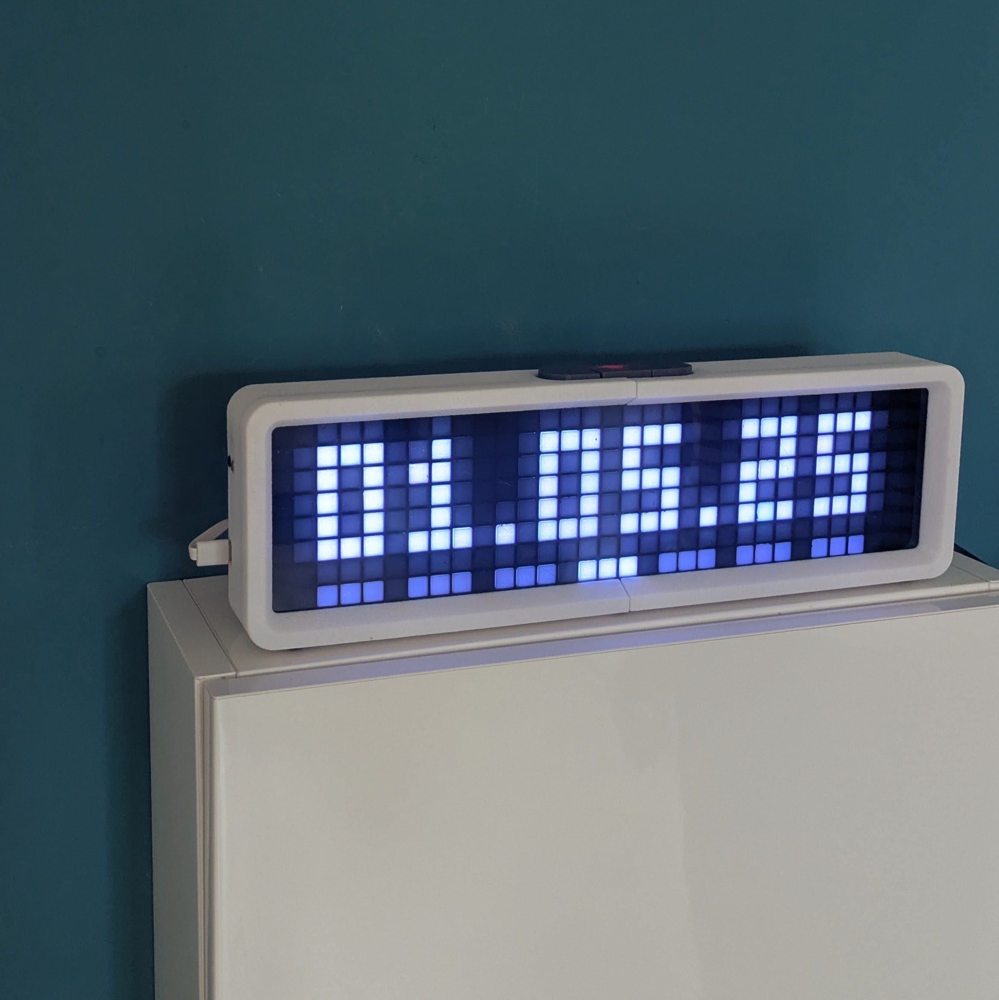
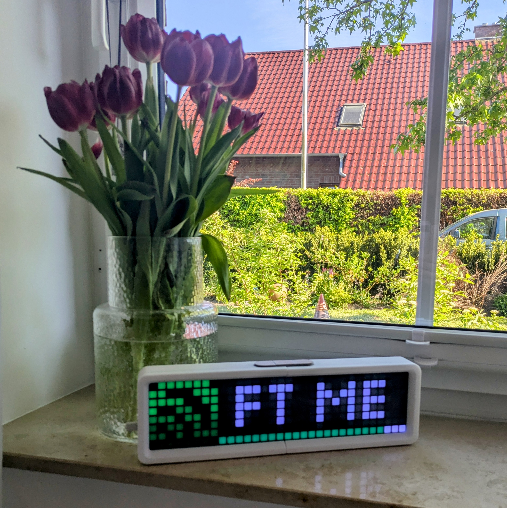
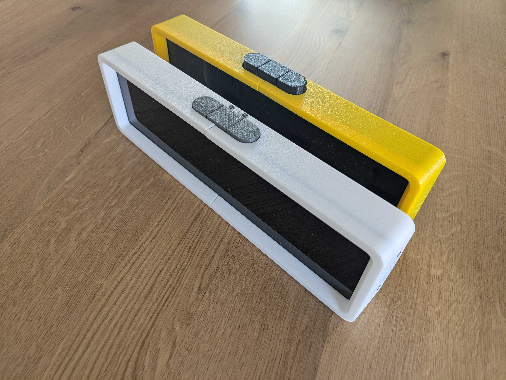
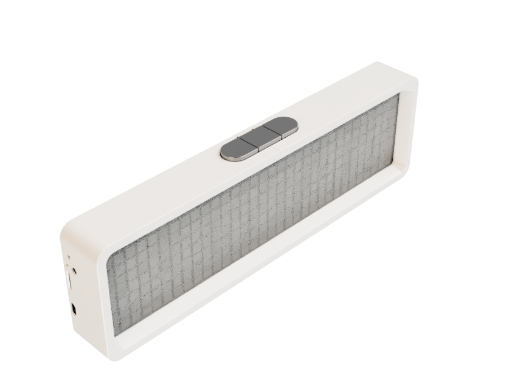
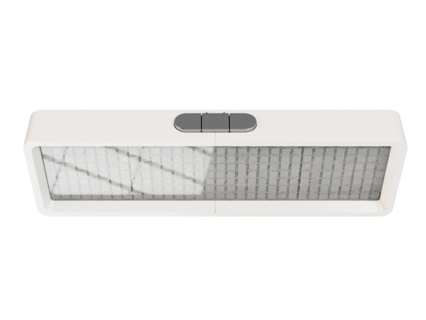
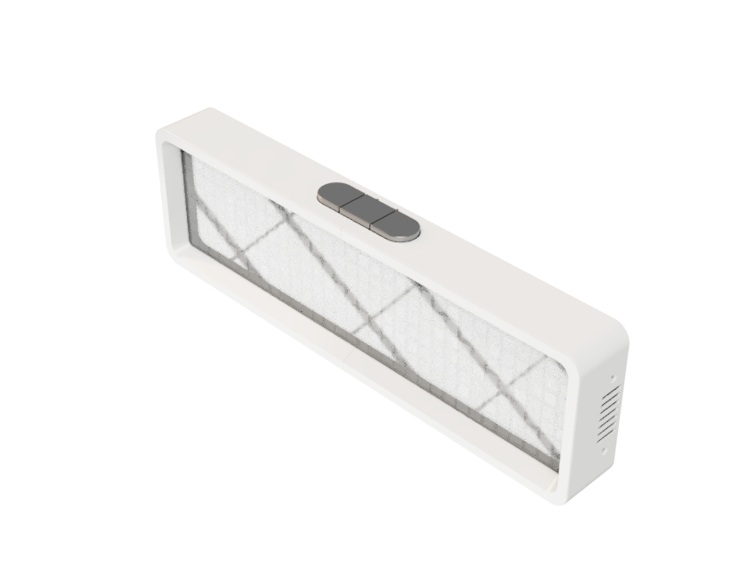
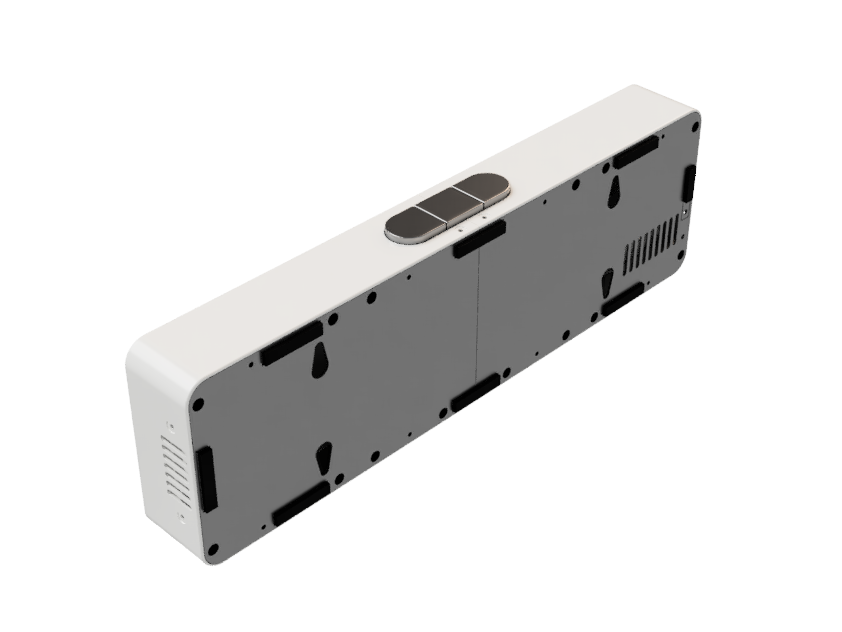

# Ultra-low-cost AWTRIX build

Build your own [AWTRIX](https://github.com/Blueforcer/awtrix3) pixel clock for **under $20** instead of ~$50 for the Ulanzi Pixel Clock, in a professional-looking 3D-printed case with swappable covers. Full source code for AWTRIX is available in the [AWTRIX repo](https://github.com/Blueforcer/awtrix3).

AWTRIX is an amazing and highly flexible visualization companion for smart home applications and more. It was originally designed to be flashed onto the Ulanzi Pixel Clock (priced at around $50), but it also supports custom builds. I wanted a fully featured custom build with a professional look at a much lower price and couldn't find a comprehensive guide, so I created one.

## Features
- **Affordable**: Base build costs under $20, while the full feature set is around $25.
- **3D printer friendly**: Designed to fit most popular 3D printers with a minimum bed size of 175mm.
- **High-quality display**: 32x8 pixel WS2812B LED matrix with a light diffuser for a clean "pixelated" look and a sleek "full black" effect when turned off.
- **Customizable design**: Easily interchangeable covers in different colors and textures.
- **Flexible mounting**: Can be wall-mounted using nails or screws, or used as a standing or laying device.
- **Optional features**:
    - Light sensor for automatic brightness adjustment.
    - DFPlayer Mini for MP3 playback.
    - Buzzer for notifications or alarms.

## Examples
| Time/date (AWTRIX build in) | Spotify (Custom app) | Customization example (different covers) |
| --------------------------- | -------------------- | ----------------------------------------- |
|  |  |  |

## Notes
- **Battery support**: This build does not include battery support, as the high power demands of the display make it impractical.
- **Temperature/humidity sensor**: A sensor is not included in the housing because the heat generated by the display would affect accuracy. Instead, you can use an external weather station sensor and display its readings on the AWTRIX screen.

# Index
- [Buy parts](#buy-parts)
- [Printing and assembly](#printing-and-assembly)
- [Customization ideas](#customization-ideas)
- [Acknowledgements](#Acknowledgements)

## Buy parts

Mandatory parts:

| Unit price | Quantity | Partname | Example | Notes |
| ---------- | -------- | -------- | ------- | ----- |
| 5 USD      | 1        | ESP32 Dev Module | <a href="https://de.aliexpress.com/item/1005006124752051.html">AliExpress</a> | Designed for WROVER USB-C type. Other types fit but may require glue |
| 8 USD      | 1        | WS2812B matrix 8x32 | <a href="https://de.aliexpress.com/item/4001296811800.html">AliExpress</a> |  |
| 1 USD      | 1        | 4 pushbutton element | <a href="https://de.aliexpress.com/item/1005008219549275.html">AliExpress</a> | Connect the outputs of the two middle buttons to "OR" their signal. Unsolder the LED for a cleaner look. |
| 2 USD      | 1        | semi-transparent acrylic board | <a href="https://de.aliexpress.com/item/32857098929.html">AliExpress</a> | Optional. Best results with semi-transparent black acrylic (2mm thick). Thinner sheets may need glue. Minimum size: 338x98mm. |
| <1 USD     | 25       | Flathead screws M2,5 or M3. 6mm. e.g. DIN 7984 | <a href="https://de.aliexpress.com/item/1005006166060947.html">AliExpress</a> | Use low-head screws (e.g., laptop screws) for a better appearance. |

Optional parts:

| Unit price | Quantity | Partname | Example | Notes |
| ---------- | -------- | -------- | ------- | ----- |
| 1 USD      | 1        | DF Player mini | <a href="https://de.aliexpress.com/item/1005006166800318.html">AliExpress</a> | For MP3 playback |
| 1 USD      | 1        | Loudspeaker (8 Ohm) | <a href="https://de.aliexpress.com/item/1005006358049156.html">AliExpress</a> | For MP3 playback. Watch for dimensions |
| <1 USD     | 1        | Buzzer | <a href="https://de.aliexpress.com/item/1005004883467830.html">AliExpress</a> | For notifications or alarms. |
| <1 USD     | 1        | LDR (GL5516) | <a href="https://de.aliexpress.com/item/1005003021557603.html">AliExpress</a> | For automatic brightness adjustment. |

## Printing and assembly

| 45° | top | -45° | back |
| -------- | --- | --------- | ---- |
|  |  |  |  |

The printing and assembly process consist of 5 steps:
- [Step 1: Diffusor](./instructions/step_1.md)
- [Step 2: Base](./instructions/step_2.md)
- [Step 3: Pushbuttons](./instructions/step_3.md)
- [Step 4: Covers](./instructions/step_4.md)
- [Step 5: Anti-slip pads](./instructions/step_5.md)

Printer Settings:
- <B>Material</B>: PETG for most parts, TPU for anti-slip pads, and PLA for the diffuser.
- <B>Orientation</B>: Print parts as shown in the thumbnails for the best results.
- <B>Infill</B>: 20% Gyroid infill with Hilbert curve for first/top layers.
- <B>Supports</B>: Not required unless explicitly mentioned.
- <B>Surface Finish</B>: Use "fuzzy skin" for a textured look on outer walls.
- <B>Rafts/Brims</B>: Not required for any model.

## Customization ideas

The housing offers several customization options:
- Add optional features like the buzzer or light sensor.
- Print covers in different colors or textures.
- Use effects like "fuzzy skin" for a unique appearance.

## Troubleshooting

### External Power

Powering the ESP32 via USB may cause brownouts under LED load. To resolve this, supply regulated 5V directly to the 5V/VIN rail (with a common ground). Use a sufficiently rated 5V supply and thick wiring. Avoid feeding 5V into the USB connector unless using proper power-path/diode.

## Acknowledgements

- Special thanks to Blueforcer for creating the incredible AWTRIX3 project.

## Development

Contributions are welcome.  
See `CONTRIBUTING.md` for details and follow the `CODE_OF_CONDUCT.md` when contributing.

## License

This project is licensed under the Creative Commons Attribution-ShareAlike 4.0 International License (CC BY-SA 4.0) — see `LICENSE.txt` for details or visit http://creativecommons.org/licenses/by-sa/4.0/

## Authors

- Simon Gerlach <https://github.com/Smenger>

---

If something in this README is missing or unclear, please open an issue in the repository so the instructions can be improved.

